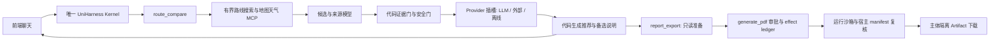

# 路线比较与面试演示

## 默认行为与 Provider 选择

`route_plan` 的 `route_compare` 最多接收五条候选（name、city、origin、destination）。默认 `ROUTE_DECISION_PROVIDER=llm`，复用服务端 `OPENAI_*` 配置。LLM 只输出候选 ID 排序与启发式 confidence，不生成路线事实。格式错误、超时、鉴权失败均返回不可用状态，绝不自动切换到确定性数据。

`ROUTE_DECISION_PROVIDER=external` 才加载 `ROUTE_DECISION_EXTERNAL_ADAPTER`。默认可选适配器使用 TypeSafe System One HTTP API，以 Jev Score 同批评估候选偏好匹配。模型与 URL 可配置，`TYPESAFE_API_KEY` 仅留在服务端。核心 Provider 插槽不依赖 Jev SDK；默认路径不加载该适配器。`calibrated` 描述该模型的 confidence 语义，不表示已在徒步领域完成安全概率校准。

`deterministic` 仅允许 `ROUTE_COMPARE_DATA_MODE=offline`，没有生产故障降级用途。离线数据是带明显标记的合成资料，来源指向 `example.org/demo`，不可据此出行。默认仍是 `live` 数据。

## 架构与强制边界



- 模型提供搜索词；候选事实由服务端工具采集。搜索星级与自由文本不能填充路线数字。适配器只转换明确的结构字段（例如地图 distance 米 → distance_km）。事实必须对应源 ID 与 canonical 字段值，否则置空并说明缺口。最终 SSE 正文也由代码生成，模型在工具后编造的数字不会进入结果。
- 天气、开放状态、风险缺失或无法判断默认要求补资料；实时安全资料过期（六小时）或时间未知不能直接推荐。高德 `reporttime` 按中国时区解析，缺失观测时间保留 `unknown`。仅已识别的晴/多云/阴等常规天气可以通过正常天气门；其他天气要求确认，雷暴/雷阵雨等严重天气、封闭路线、高风险强制 no-go；中等风险需要人工确认。硬规则无法由 Provider 输出覆盖。
- 地图距离是地图工具的线路距离；地图导航链接不证明官方开放状态、山区爬升或徒步安全。现有 `route_research` 只返回搜索摘要时，爬升/开放/风险保持缺失。这种真实路径会产生可解释的资料不足状态，不能作为完整真实徒步路线推荐。
- 路线比较内部 MCP 沿用现有 registry 的服务器/工具 allowlist、凭证隔离、超时与大小上限，并记录 tool_call/tool_result。使用已核对的官方 `@amap/amap-maps-mcp-server@0.0.8`，将采集操作映射为 `maps_geo`、`maps_direction_walking`、`maps_weather`。部署仍使用 `AMAP_API_KEY`，宿主仅在启动官方服务时转换为其要求的 `AMAP_MAPS_API_KEY`。官方天气返回日期化的昼夜预报并省略观测时间，保留预报标签与未知时间，不将其视作实时安全证明。连接失败进入缺口结果，不在 Kernel 装配阶段提前吞掉降级说明。没有工具返回的事实绝不用模型补齐。
- `report_export` 接收服务器签发的 comparison_id；仅从当前运行或同一已授权会话的持久化 SSE 结果取数据，重新检查证据/安全后才准备报告。实际生成仍经原有 HIGH 风险 generate_pdf 审批、暂停/恢复、CAS effect、沙箱清理、SHA/MIME 校验和 opaque Artifact ID。跨主体下载返回 404。
- 前端来源可逐项展开；普通 LLM、外部模型及 confidence 语义单独展示。no-go/部分资料/确认/不可用均不显示正常推荐或完整报告导出按钮。

## 可重复的命令行演示

在 `ai-service` 运行以下命令。CLI 使用**显式演示路由**选定工具，真实生产聊天仍只走 Kernel；`llm` 和 `external` 的决策请求使用真实服务配置，`deterministic` 不联网。每次使用新的 request_id，生成时间与 Artifact ID 自然变化。

```powershell
python -m scripts.eval_route_compare --output ../.scratch/route-compare-decision-provider/regression.json
python -m scripts.demo_route_compare --provider deterministic --output-dir ../.scratch/route-compare-decision-provider/demo-offline --pdf --approve-pdf
python -m scripts.demo_route_compare --provider llm --output-dir ../.scratch/route-compare-decision-provider/demo-llm --pdf --approve-pdf
python -m scripts.demo_route_compare --provider external --output-dir ../.scratch/route-compare-decision-provider/demo-external --pdf --approve-pdf
python -m scripts.demo_route_compare --provider deterministic --scenario empty --output-dir ../.scratch/route-compare-decision-provider/demo-empty --pdf --approve-pdf
python -m scripts.demo_route_compare --provider deterministic --scenario severe_weather --output-dir ../.scratch/route-compare-decision-provider/demo-no-go --pdf --approve-pdf
```

`--approve-pdf` 明确批准本次演示的 PDF；省略时停在审批暂停，PDF 尚未生成。`demo.json` 包含结构化比较、事件类型和公开 Artifact 元数据。PDF 保存在该输出目录的 Artifact 存储中，数据库中保留下载/归属和 lease/effect 记录。CLI 不输出 subject token、API Key 或提示词。

演示顺序：默认 LLM 推荐与备选 → 外部 Jev 切换与 confidence → empty 不编造 → severe_weather no-go → PDF 审批、来源、元数据与 Artifact 隔离。完整离线样例是“演示林间环线”和“演示山脊路线”；partial、empty、caution、severe_weather 有独立样例。

## 浏览器演示

设置服务端 `ROUTE_COMPARE_DATA_MODE=offline` 与所需 Provider 后重启服务，点击“推荐路线”并输入：

> 比较演示林间环线和演示山脊路线，所在城市为演示城市，两条的起点为起点、终点为终点，优先轻松路线。

展开各距离/天气等事实的来源；点击“导出带来源 PDF”，在原有审批界面确认后下载。切换 `ROUTE_COMPARE_DEMO_SCENARIO=empty` 或 `severe_weather` 重启，再演示资料不足和危险状态。切回 `ROUTE_COMPARE_DATA_MODE=live` 才会请求真实工具，保留所有缺口。

## 回归与验收

```powershell
python -m pytest test_route_decision_provider.py test_route_comparison.py test_route_compare_tools.py test_route_report_export.py -q
python -m pytest -q
python -m compileall -q route_compare agent_v2 scripts
```

前端 `npm run build` 包含 TypeScript 检查；Gateway `go test ./...`。18 项离线评估覆盖三种 Provider 的完整/部分/空资料、严重天气、中等风险，以及 Provider 与 MCP 不可用。断言依据业务状态、推荐与导出能力，不依赖模型固定措辞。

票据映射：01–03 Provider 契约与适配器；04 候选/来源与样例；05 Kernel/SSE 最小闭环；06–07 强制证据/安全门；08 实时工具转换与缺口；09 评估脚本；10 聊天结果卡片；11 审批/来源 PDF 与 Artifact；12 本文和演示脚本。

真实地图/天气 MCP 仍取决于部署中配置的服务器及凭证。缺少完整山区数据时应演示“资料不足”，不要把离线合成资料或地图步行线路包装成真实安全推荐。生产 E2B 的既有实现限制未由本系列替换；生产沙箱不可用时仍 fail-closed。
